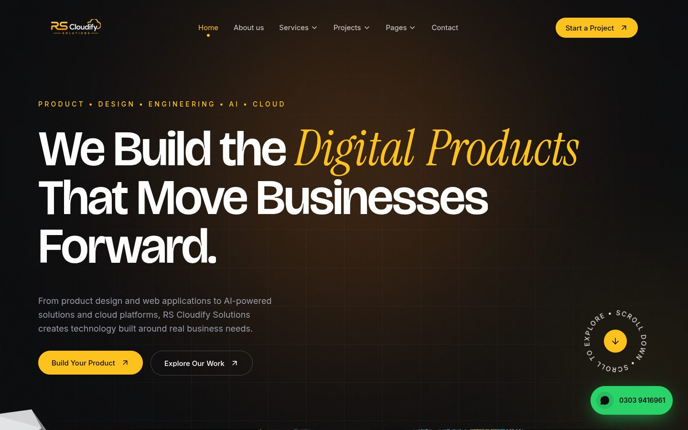
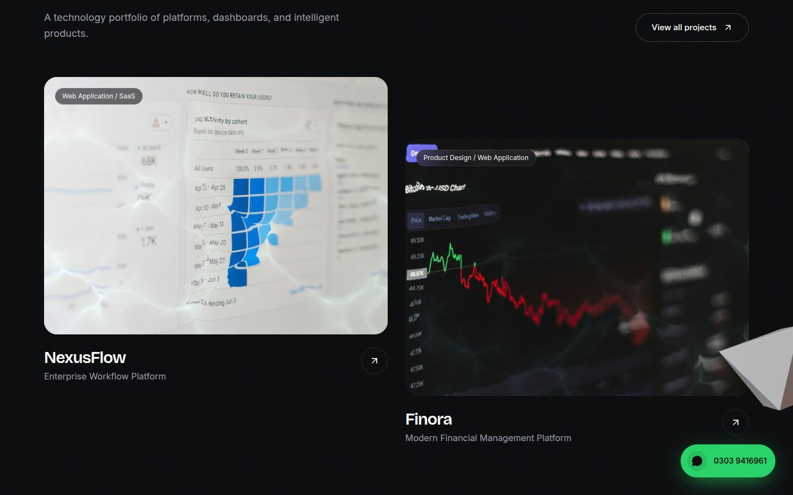
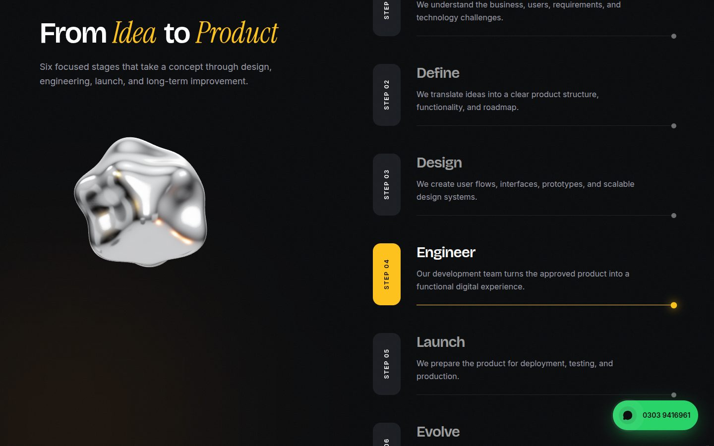

<div align="center">

# RS Cloudify Solutions

**Website for a technology and product engineering company — React, Vite, GSAP, Framer Motion, three.js and WebGL.**



</div>

---

A 14-route marketing site built around the client's content file: 8 services, 6 projects, a 6-stage process, team, testimonials and FAQ. All copy lives in **one data file**, so content changes never require touching components.

> **Placeholder content to replace before launch:** the team names/photos, the testimonial quotes (all marked "Client Name"), and every image (free-licence Unsplash stock, credited in `public/images/credits.json`).

## Contents

- [Highlights](#highlights)
- [Pages](#pages)
- [Tech stack](#tech-stack)
- [Getting started](#getting-started)
- [Project structure](#project-structure)
- [Editing content](#editing-content)
- [Brand and theme](#brand-and-theme)
- [Tuning the effects](#tuning-the-effects)
- [Deployment](#deployment)
- [Performance and accessibility](#performance-and-accessibility)

## Highlights

| | |
|---|---|
|  |  |
| *Ripple images, focus-blur hover, cursor-following arrow* | *Scroll-driven 3D object and active-step tracking* |

**Motion and interaction**
- Curtain **page transitions**, a **preloader** with a 0–100% counter, and smooth scrolling (Lenis) wired into GSAP ScrollTrigger.
- **Split-text headlines** — wrap a word in `*asterisks*` in the data file to set it in the italic serif accent.
- Scroll storytelling: the intro statement lights up word by word, the hero visual expands to full width, and process steps highlight as they reach the middle of the screen.
- **Magnetic buttons**, a morphing **cursor follower**, and a header that hides on scroll-down.

**Visual effects**
- **Chrome 3D landmarks** (three.js) anchored at fixed points down the page edges, rotating in place as you scroll past.
- A **wireframe "blueprint" object** in the technology section that rotates with scroll.
- **Water-ripple images** (WebGL shader) — calm at rest, stronger on hover. Deliberately **off for team portraits**, where it distorts faces.
- **Jump-in images**, **light-beam card outlines**, and **focus grids** where the hovered image stays sharp while its neighbours blur.
- **Footer wordmark**: the company name filled with a grain texture, drifting and scaling as you scroll into the footer.

**Contact**
- Floating **WhatsApp button**, plus phone and WhatsApp in the footer, mobile menu, CTA band and contact page.
- The Contact page and footer display the current business address, phone number, and email.

## Pages

| Route | Page |
|---|---|
| `/` | Home |
| `/about` | About us |
| `/services` | Services overview (8 services) |
| `/services/:slug` | Service detail — one page per service |
| `/projects` | Projects with category filters (6 projects) |
| `/projects/:slug` | Project detail |
| `/team` | Team grid |
| `/team/:slug` | Team details — one page per member |
| `/testimonials` | Testimonials |
| `/faq` | FAQ |
| `/contact` | Contact form, phone and WhatsApp |
| `*` | 404 |

Navbar: **Home · About us · Services ▾ · Projects ▾ · Pages ▾ · Contact**. Services and Projects are links that also open a dropdown of every item; Pages holds Team Grid, Team Details, Testimonials and FAQ.

## Tech stack

- **[React 19](https://react.dev)** + **[React Router 7](https://reactrouter.com)**
- **[Vite 8](https://vite.dev)**, **[Tailwind CSS 4](https://tailwindcss.com)** (tokens in `src/index.css`)
- **[Framer Motion](https://motion.dev)**, **[GSAP + ScrollTrigger](https://gsap.com)**, **[Lenis](https://lenis.darkroom.engineering)**
- **[three.js](https://threejs.org)** for 3D, raw **WebGL** for the ripple shader, **[lucide-react](https://lucide.dev)** for icons

JavaScript (JSX) throughout, with TypeScript supported alongside for `.tsx` components in `src/components/ui/`.

## Getting started

**Requirements:** Node.js 20.19+ (or 22.12+) and npm.

```bash
git clone https://github.com/Muneeb50702/orbit.git
cd orbit
npm install
npm run dev
```

Open http://localhost:5173.

| Command | What it does |
|---|---|
| `npm run dev` | Dev server with hot reload |
| `npm run build` | Production build into `dist/` |
| `npm run preview` | Serve the production build on port 4173 |

## Project structure

```
src/
├── data/site.js          ← ALL content: brand, nav, services, projects, team, FAQ…
├── index.css             ← design tokens, beam outlines, focus grid, footer wordmark
├── App.jsx               ← routes, preloader, page transitions, WhatsApp button
├── pages/                ← one file per route
├── sections/             ← Hero, ServicesList, ProjectsGrid, TechApproach, WhyUs…
├── components/           ← Header, Footer, Logo, Button, Cursor, ParallaxImage…
│   └── ui/
│       └── water-ripple-image.tsx   ← WebGL ripple image
├── animations/           ← SplitText, Reveal, JumpIn, PageTransition, easing
└── lib/
    ├── scroll.js         ← Lenis + ScrollTrigger
    ├── chrome.js         ← three.js renderer, chrome materials, procedural shapes
    ├── floatingScene.js  ← chrome landmarks down the page edges
    └── objectScene.js    ← single 3D object inside a section
public/
├── logo.png              ← client logo, recoloured to the theme
└── images/               ← 35 photos + credits.json
```

## Editing content

Everything is in **[`src/data/site.js`](src/data/site.js)**.

| To change… | Edit |
|---|---|
| Company name, phone, WhatsApp number, tagline, motto | `brand` |
| Navbar | `nav` |
| Hero headline, label, buttons | `hero` |
| Services (these generate `/services/:slug`) | `services` |
| Projects (these generate `/projects/:slug`) | `projects` |
| Team (these generate `/team/:slug`) | `team` |
| Process, technology groups, why-us, FAQ, testimonials, CTA, contact | matching exports |

**Accent words:** wrap a word in asterisks, e.g. `'We Build the *Digital* *Products* …'`.

**Images:** drop files into `public/images/` and reference them as `/images/name.jpg`. Images must be served from this site (or a host that allows cross-origin use) or the ripple quietly falls back to a plain image.

**Contact form:** currently simulates sending — connect Formspree, EmailJS or your own API at the `TODO` in [`src/pages/Contact.jsx`](src/pages/Contact.jsx).

## Brand and theme

- **Palette:** yellow accent `#ffc21a` on deep graphite `#08090b`, with a warm amber glow `#ff8a1e`. All three are tokens at the top of [`src/index.css`](src/index.css) — change `--color-accent` and every accent follows.
- **Logo:** `public/logo.png` is the client's logo recoloured to the theme (orange → yellow, navy → white, background made transparent). The design itself is unchanged.
- **Type:** Bricolage Grotesque (display), Inter (body), Instrument Serif (italic accent).

## Tuning the effects

| Effect | Where | Knobs |
|---|---|---|
| Image jump-in | `src/animations/JumpIn.jsx` | `bounce`, `duration`, `y`, blur |
| Water ripple | `src/components/ui/water-ripple-image.tsx` | `idle`, `zoom`, `illumination`, distortion props |
| Chrome landmarks | `src/lib/floatingScene.js` | `SPACING` (screens between objects), `FIRST` |
| Section 3D object | `<ObjectCanvas shape="blob" />` / `<ObjectCanvas wire />` | `knot` `star` `cubes` `blob` `ring` `gem` `twist` `capsule` `octa` |
| Card beam outline | add `className="beam"` | `.beam::before` in `src/index.css` |
| Footer wordmark | `src/components/FooterWordmark.jsx` | drift/scale range; texture in `.footer-wordmark` |

## Deployment

Static single-page app — `npm run build` writes to `dist/`. `public/_redirects` sends every route to `index.html` so deep links work on Netlify.

```bash
npm run build
netlify deploy --prod --dir=dist
```

Vercel, Cloudflare Pages and GitHub Pages also work; configure an SPA fallback to `index.html`.

## Performance and accessibility

- three.js loads lazily in its own chunk; 3D and ripple canvases only run while on screen.
- `prefers-reduced-motion` disables smooth scrolling, the 3D layer and the ripple effect.
- Every ripple image keeps a real `` underneath for alt text and fallback.
- Semantic headings, labelled controls, `aria-expanded` on menus and accordions, `aria-hidden` on decorative layers.
# rscloudify

# rscloudify

# rscloudify

# project-rscloudify

# project-rscloudify

